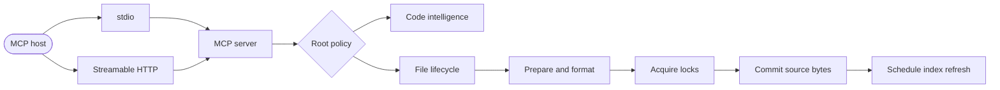

ast-mcp separates protocol handling from repository policy and mutation mechanics.

## Protocol layer

Stdio supports JSON-RPC batches while preserving one framed response per request and no response for notifications; it keeps one connection state per process. Modern Streamable HTTP is stateless, uses SSE by default, and requires neither initialize nor an MCP session header. Pass `workspaceId` to reuse application workspace handles within the running server. Legacy HTTP clients retain isolated sessions with bounded idle cleanup.

## Policy layer

Every path-bearing intelligence and file operation passes through the same configured-root policy. This keeps discovery and mutation inside one trust boundary.

## Mutation layer

Structural patches and Aider blocks converge on the same candidate pipeline: validate current state, transform, optionally format, lock, recheck, and atomically replace. The operation never treats successful text generation as permission to overwrite stale state.

## Helper boundaries

Cross-cutting normalization, parsing, process capture, installer routing, configuration traversal, and MCP schema contracts live in `src/helpers/`, segmented by responsibility. Public modules keep their established entry points while delegating pure transformations to these focused helpers, which keeps protocol and mutation orchestration small and independently testable. Website-only URL normalization follows the same boundary under `website/src/helpers/`.

Fallow analyzes every duplicated pair (`minOccurrences = 2`) so reusable behavior is consolidated early instead of growing into parallel implementations.

## Distribution

The npm package exposes `ast-mcp` through the platform executable or the fallback Bun bundle. Both forms share these commands:

- `ast-mcp mcp` starts stdio by default; `--transport http` starts Streamable HTTP
- `ast-mcp hook` runs blocking host hooks
- `ast-mcp install` reconciles host configuration, hooks, and managed instructions; `update` and `uninstall` manage them afterward
- `ast-mcp skills export <destination>` exports the canonical MCP skill for clients without Skills support

The installed CLI resolves native intelligence dependencies from the package's stable dependency tree. Formatting uses only external commands that users install and configure. The server serves canonical skill content over MCP; export is explicit and preserves existing files.
