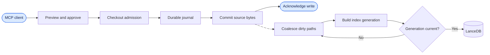
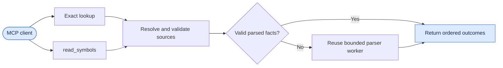

AST-MCP 0.8.0 adds bounded symbol reads, coalesces index refreshes, and reduces contention during guarded writes. It ships six standalone ESM bytecode builds with Bun embedded. [GitHub release](https://github.com/mwillbanks/ast-mcp/releases/tag/ast-mcp-v0.8.0)

## Guarded writes

A private SQLite recovery journal records source mutations. LanceDB continues to hold the intelligence index. Writes acknowledge durable source bytes before scheduled index refresh finishes. One refresh job per checkout coalesces dirty paths, rebuilds outside the writer lease, and checks that the generation still applies before publishing it.



The matched replay used 16 clients on one checkout, five interleaved rounds of 200 warm attempts per cell, an Apple M5 Max, and Bun 1.4.4. Both revisions used the same fixtures, deadlines, and exact-byte checks. The pinned baseline was `0b18e8987c325fb6306c55f1028f52df837de284`. The baseline missed deadlines on most indexed writes, so its throughput counts verified completions only.

```mermaid
xychart-beta
  title "Verified two-file transactions per second"
  x-axis ["TypeScript", "Rust", "Go"]
  y-axis "Transactions per second" 0 --> 25
  bar [0.53, 0.59, 0.60]
  bar [19.35, 21.28, 21.17]
```



The first series is the baseline. The second series is the release promotion candidate.

| Indexed write | Verified transactions/s, baseline → candidate | Warm completions, baseline → candidate | Deadline failures, baseline → candidate | Peak RSS, baseline → candidate |
| ------------- | --------------------------------------------: | -------------------------------------: | --------------------------------------: | -----------------------------: |
| TypeScript    |                                  0.53 → 19.35 |                            330 → 1,000 |                                 670 → 0 |             11,039 → 5,593 MiB |
| Rust          |                                  0.59 → 21.28 |                            361 → 1,000 |                                 639 → 0 |             10,997 → 5,884 MiB |
| Go            |                                  0.60 → 21.17 |                            365 → 1,000 |                                 635 → 0 |             10,886 → 5,799 MiB |

Candidate TypeScript warm write latency was **789 / 1,041 / 1,135 ms** at p50 / p95 / p99. Summed process-tree RSS is an upper bound because processes can share pages.

### Publication fence confirmation

The reviewed release source reran the three indexed write cells and the paired TypeScript write and retrieval cell. Each cell verified 1,000 warm workflows. All 20 rounds caught up after the writes stopped.

| Reviewed source                 |          p50 / p95 / p99 | Verified workflows/s |
| ------------------------------- | -----------------------: | -------------------: |
| TypeScript indexed write        |       694 / 889 / 953 ms |                21.88 |
| Rust indexed write              |       704 / 869 / 929 ms |                21.48 |
| Go indexed write                |       716 / 843 / 953 ms |                21.42 |
| TypeScript write with retrieval | 1,197 / 1,476 / 1,710 ms |                12.44 |

The paired read used a reduced-symbol fixture and returned a marked retained generation in all 1,000 workflows. The symbol-heavy diagnostic found no eligible retrieval candidates, so it provides no qualified throughput result. Retrieval took 869 ms at p95 and remained the largest timed stage. The write-only cells met the throughput and latency targets. Peak summed RSS remained above 2 GiB.

## Exact and batched symbol reads

`read_symbols` handles a bounded batch with ordered per-item outcomes. Exact reads reuse parser workers and parsed facts. The cache is invalidated when the source or its configuration changes.

```mermaid
xychart-beta
  title "Exact lookup p95 latency at 16 clients"
  x-axis ["1,000 files", "10,000 files"]
  y-axis "Milliseconds" 0 --> 180
  bar [165.98, 129.06]
  bar [49.14, 43.92]
```





The first series is the baseline. The second series is the release promotion candidate. Each cell verified 1,000 warm lookups.

| Exact lookup | Verified results/s, baseline → candidate |    Baseline p50 / p95 / p99 | Candidate p50 / p95 / p99 | Peak RSS, baseline → candidate |
| ------------ | ---------------------------------------: | --------------------------: | ------------------------: | -----------------------------: |
| 1,000 files  |                          132.42 → 377.18 | 106.84 / 165.98 / 209.26 ms |  40.07 / 49.14 / 53.78 ms |              4,335 → 3,991 MiB |
| 10,000 files |                          146.08 → 393.45 | 102.58 / 129.06 / 153.00 ms |  39.36 / 43.92 / 45.39 ms |              4,429 → 4,014 MiB |

### Exact-read replay evidence

Both variants ran on an Apple M5 Max with Bun 1.4.4, using source launch over stdio. The published rows use 16 clients and five interleaved rounds of 200 warm observations. The baseline was `0b18e8987c325fb6306c55f1028f52df837de284`. The timed candidate was a local promotion snapshot on that baseline with the promoted fixes, identified by `release-source-final.json`. The later [merged implementation](https://github.com/mwillbanks/ast-mcp/commit/9cb33be397885c2dd527ae2b09e57417874fa234) includes subsequent review changes.

These are the recorded commands. Run them from the archived candidate checkout with its dependencies installed. Set `baseline` to the pinned baseline checkout with its dependencies installed, and `results` to the output directory.

```bash
common=(--launches=source,pre-fix --pre-fix="$baseline" --modes=stdio
  --samples=1000 --runs=5 --cpu=process-tree)
bun scripts/benchmark/experiment-replay.ts "${common[@]}" \
  --workloads=exact,mixed,references --read-mode=bounded --clients=1,4,16 --size=1000 \
  --output="$results/release-final-reads.json"
bun scripts/benchmark/experiment-replay.ts "${common[@]}" \
  --workloads=exact --clients=1,4,16 --size=10000 \
  --output="$results/release-final-exact-10k.json"
```

The replay harness, source manifest, and raw samples remain in the local experiment archive. The public PR records the matched results and review discussion.

[Matched replay and review evidence](https://github.com/mwillbanks/ast-mcp/pull/76)

## Native packs and distribution

Use `ast-mcp pm list`, `pm install <pack>`, and `pm doctor` for the pinned Python, Go, and SQL packs. Installed packs support offline use. Explicit installation is the default.

GitHub Releases provides macOS arm64, Linux arm64 and x64 for glibc and musl, and Windows x64 builds. Keep the extracted `runtime/` directory beside the executable. Alpine arm64 requires `gcompat` for the bundled Markdown parser. The npm package in 0.8.0 runs the JavaScript bundle with Bun.
