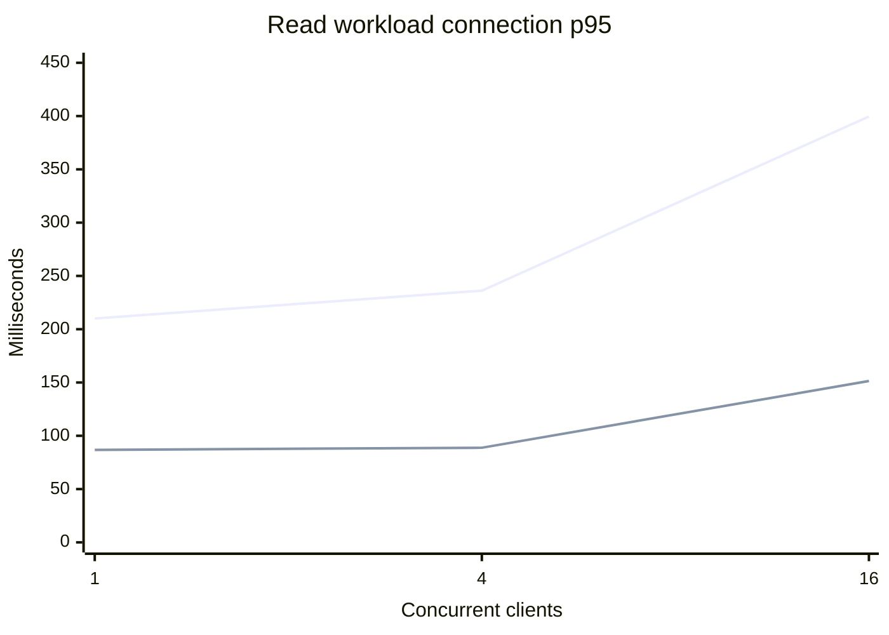
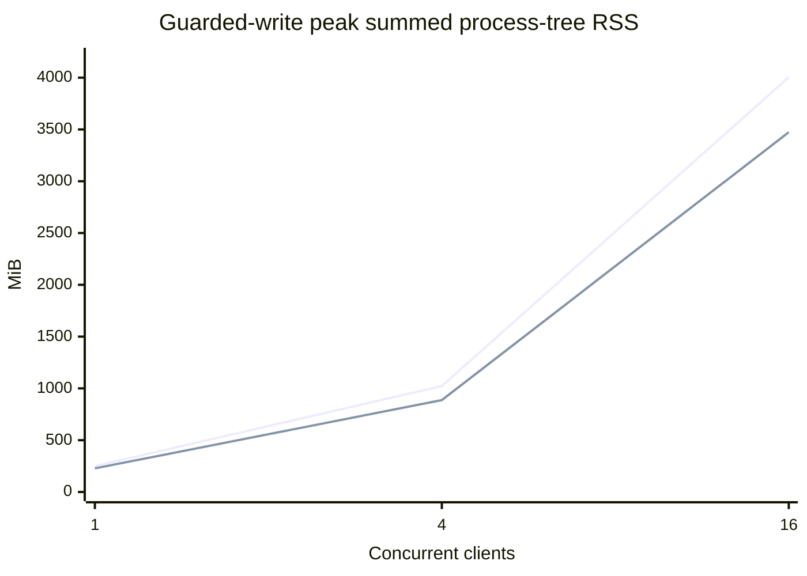
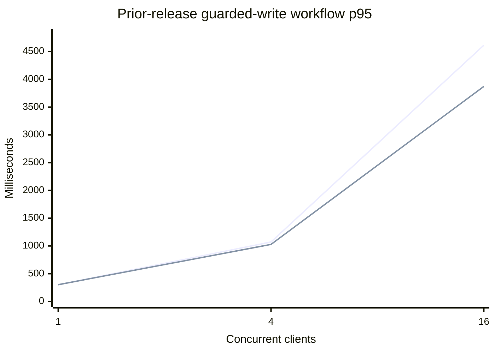

## Native npm installs

`npm install -g @mwillbanks/ast-mcp` selects a compiled build on supported platforms. npm is used during installation. The executable embeds Bun, and managed MCP entries can run the executable directly.

The npm package retains the Bun bundle for platforms without a matching compiled build. See the [installation guide](/docs/getting-started/installation/) for supported targets and the Alpine arm64 prerequisite.

## Documentation

The documentation now includes per-release notes and shows the index refresh and guarded write flows.

## Performance

The compiled 0.9.0 executable reduced connection p95 by **58.66–64.09%** across the measured read and guarded-write workloads. Guarded-write peak RSS fell **8.97–13.25%**. Read throughput rose 2.23–5.74%. At 4 and 16 read clients, peak RSS grew 3.59% and 5.41%.

The prior-release bundle comparison also improved under load. At 16 clients, 0.9.0 delivered 20.17% more read throughput and 14.57% more guarded-write throughput than 0.8.0. Guarded-write p95 fell 16.08%. One-client read throughput fell 1.22%, and one-client guarded-write throughput fell 0.07%.

## Benchmark comparison

These retrospective measurements ran on November 20, 2026, using the shipped npm packages on an Apple M5 Max. The host ran macOS 27.2.1, Darwin arm64, Bun 1.4.4, 18 available CPU cores, and 128 GiB RAM.

Each comparison used five alternating paired rounds, two workflows per client, and 1, 4, or 16 clients sharing one checkout. The read workload maps a TypeScript fixture and verifies its expected symbol. The guarded-write workload supplies an expected SHA-256, patches a dedicated client file, and verifies exact resulting bytes.

Values show the median of five per-round observations. Latency columns use each round's p95. Peak RSS sums sampled owned processes and can count shared memory more than once. Throughput counts correct workflows. Percentiles include failed attempts.

### Bun bundle and compiled executable

Both variants run the shipped 0.9.0 package through dedicated stdio. The bundle uses the host's Bun runtime. The compiled executable embeds its runtime.

| Workload      | Clients | Connection p95 ms, bundle → native | Workflow p95 ms, bundle → native | Correct workflows/s, bundle → native | Peak RSS MiB, bundle → native |
| ------------- | ------: | ---------------------------------: | -------------------------------: | -----------------------------------: | ----------------------------: |
| Read          |       1 |                     210.01 → 86.81 |                    99.40 → 96.85 |                        13.44 → 13.74 |               211.72 → 211.14 |
| Read          |       4 |                     236.17 → 88.78 |                  122.25 → 117.34 |                        43.57 → 46.07 |               823.63 → 853.16 |
| Read          |      16 |                    399.60 → 151.38 |                  217.48 → 207.61 |                      102.45 → 107.87 |           3,270.59 → 3,447.63 |
| Guarded write |       1 |                     214.26 → 80.02 |                  313.57 → 303.46 |                          5.08 → 5.21 |               250.36 → 227.89 |
| Guarded write |       4 |                     246.47 → 88.50 |              1,095.41 → 1,069.53 |                          6.05 → 6.10 |             1,022.22 → 887.06 |
| Guarded write |      16 |                    398.94 → 150.12 |              4,083.19 → 3,826.72 |                          6.29 → 6.55 |           4,004.03 → 3,473.39 |

The native variant passed all 30 cells. The bundle passed 28 of 30 cells. In the 16-client guarded-write workload, the bundle completed 158 of 160 workflows. Two second-wave writes returned retryable `workspace_mismatch` errors after their dirty overlay identities changed. The native variant completed all 160. The table includes these observed failures. All variants released their owned processes and RSS after disconnect.

In the next two charts, the first line shows the Bun bundle and the second shows the compiled executable.





### Prior release

This comparison runs both shipped bundles with the same host Bun runtime and dedicated stdio. All 60 cells passed, with zero retained owned processes or RSS after disconnect.

| Workload      | Clients | Connection p95 ms, 0.8.0 → 0.9.0 | Workflow p95 ms, 0.8.0 → 0.9.0 | Correct workflows/s, 0.8.0 → 0.9.0 | Peak RSS MiB, 0.8.0 → 0.9.0 |
| ------------- | ------: | -------------------------------: | -----------------------------: | ---------------------------------: | --------------------------: |
| Read          |       1 |                  213.06 → 210.77 |                  94.87 → 96.48 |                      13.90 → 13.73 |             205.00 → 194.30 |
| Read          |       4 |                  236.48 → 232.99 |                118.75 → 114.55 |                      46.20 → 47.43 |             815.69 → 829.55 |
| Read          |      16 |                  403.75 → 366.74 |                194.47 → 197.90 |                     93.00 → 111.76 |         3,310.69 → 3,301.48 |
| Guarded write |       1 |                  199.88 → 209.49 |                301.62 → 302.65 |                        5.41 → 5.41 |             249.31 → 247.39 |
| Guarded write |       4 |                  231.04 → 226.10 |            1,071.69 → 1,027.92 |                        6.14 → 6.41 |             968.41 → 995.05 |
| Guarded write |      16 |                  381.61 → 387.56 |            4,614.28 → 3,872.51 |                        5.67 → 6.50 |         3,996.77 → 3,980.53 |

The first line shows 0.8.0 and the second shows 0.9.0.



### Measurement provenance

npm verified registry integrity while installing the exact packages with lifecycle scripts disabled. The harness came from commit `bd81694`. Report SHA-256 values identify the retained local observations.

| Measurement or executable     | SHA-256                                                            |
| ----------------------------- | ------------------------------------------------------------------ |
| 0.9.0 bundle/native report    | `1737280d508465bceb1d143daac76fdeab1647abec1700d29158f6c0bd8c0893` |
| 0.8.0/0.9.0 bundle report     | `9b06149e6b00b8cf92a8640108cafb4f284946b388f38428171e34b704b4bd76` |
| 0.8.0 bundle                  | `98fcfe9be7785298b297f423d8f159d733be4f2b0c708c7701daf49a755a4733` |
| 0.9.0 bundle                  | `6cf11ebf6cf28f36f9e82f4c24efbd7b6c8909dc62a7863101376704de51fe1b` |
| 0.9.0 Darwin arm64 executable | `b660a1bfe0123b765f146e1e777753c04860f0d74efb7e6a62560f2570917a6a` |

Reproduce each comparison with the appropriate two absolute commands. Use the 0.9.0 bundle and native executable for the first comparison. Use the 0.8.0 and 0.9.0 bundles for the prior-release comparison.

```sh
bun scripts/benchmark/shared-runtime-baseline.ts \
  --command='["/path/to/bun","/path/to/0.9.0/dist/ast-mcp.js","mcp"]' \
  --compare-command='["/path/to/0.9.0/ast-mcp-bytecode","mcp"]' \
  --clients=1,4,16 --layout=same --workloads=read,write --rounds=5 --samples=2
```
