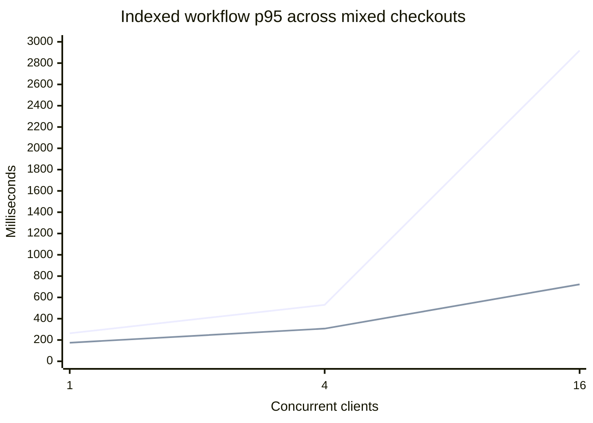
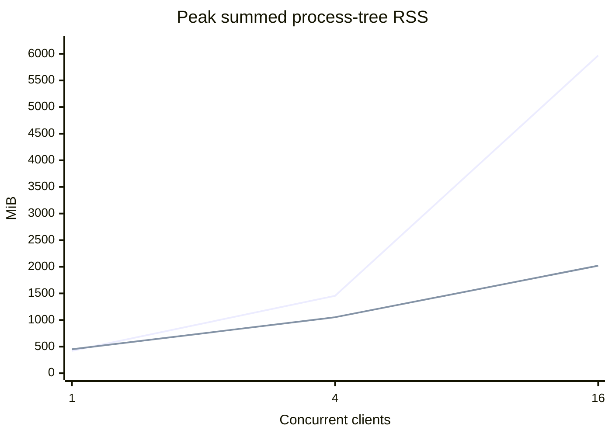

## Shared stdio

On macOS and Linux with a compatible Bun runtime, new installer-managed stdio registrations use a local broker. Windows and older Bun runtimes use a dedicated stdio server. Compatible host launches reuse the broker while keeping each MCP session's roots and approvals separate. Each checkout has its own Bun ModuleGraph intelligence runtime.

To enable sharing for an existing managed registration, run `ast-mcp update` with the original scope and target, then reconnect the host. Updating the package alone does not change launch arguments. Direct `ast-mcp mcp` and Streamable HTTP still work as before.

## Write coordination

Temporary write coordination applies only to account-owned roots on supported local POSIX filesystems. It retains the guard that older versions also use, so those writers cannot overlap operations on the same file or checkout. Other roots continue to use the existing coordination. Durable journals and snapshots stay outside the temporary database.

## Intelligence storage

New global intelligence stores live beside the global configuration. New local stores use `.ast-mcp/intelligence` at the checkout root. Linked worktrees retain the same repository identity without sharing new local storage.

AST-MCP does not move or delete legacy stores. See the [configuration reference](/docs/reference/configuration/) for the conditions under which AST-MCP uses an existing store.

## Performance

At 16 concurrent clients across mixed checkouts, shared stdio delivered **2.60× the throughput**. Workflow p95 fell **75.24%** and peak RSS fell **66.14%**. Throughput rose from 8.11 to 21.10 correct workflows/s. Workflow p95 fell from 2,918.34 to 722.59 ms. Peak summed process-tree RSS fell from 5,968.31 to 2,020.66 MiB.

At four clients, throughput rose 58.54% and peak RSS fell 27.63%. One-client throughput rose 54.57%, while peak RSS grew 6.74%. Final disconnect p95 increased by 12.87, 22.75, and 9.99 ms at 1, 4, and 16 clients. Every shared run released its owned processes and RSS after disconnect.

The shared broker reuses the compatible runtime while preserving checkout-local intelligence graphs. Checkout-local storage and temporary write coordination shipped with this release. These measurements cover the combined release behavior.

## Benchmark comparison

The recovered macOS arm64 qualification compared the compiled 0.9.0 dedicated stdio server with the compiled shared stdio runtime shipped in 0.9.1. It used five alternating paired rounds and two workflows per client. Mixed fixtures rotated a main checkout, a linked worktree, and an independent repository.

The indexed workflow applies a SHA-256-guarded patch, verifies exact file bytes, and retrieves committed evidence. It verifies fresh working evidence after the timed write waves. All 30 cells passed. Each of the 15 shared cells used exactly one broker and retained zero owned processes or RSS.

Values show the median of five per-round observations. Latency columns use each round's p95. RSS sums sampled owned process RSS and can count shared memory more than once.

| Clients | Connection p95 ms, 0.9.0 → 0.9.1 | Workflow p95 ms, 0.9.0 → 0.9.1 | Correct workflows/s, 0.9.0 → 0.9.1 | Peak RSS MiB, 0.9.0 → 0.9.1 | Disconnect p95 ms, 0.9.0 → 0.9.1 |
| ------: | -------------------------------: | -----------------------------: | ---------------------------------: | --------------------------: | -------------------------------: |
|       1 |                    83.33 → 73.05 |                263.03 → 174.50 |                        3.83 → 5.92 |             421.59 → 450.02 |                     8.15 → 21.02 |
|       4 |                    89.79 → 76.23 |                530.03 → 306.94 |                       9.19 → 14.57 |         1,454.31 → 1,052.48 |                    10.75 → 33.50 |
|      16 |                   157.06 → 97.61 |              2,918.34 → 722.59 |                       8.11 → 21.10 |         5,968.31 → 2,020.66 |                    34.82 → 44.81 |

In each chart, the first line shows 0.9.0 and the second shows 0.9.1. The table provides the exact values.





### Measurement provenance

The recovered report SHA-256 is `eece48fbb442142aecb5e99cdb8ad0cc69c69f42ffb5da324016250ece91b92b`. The baseline was release commit `3c03f2e`. Candidate `fbe853d` has the same Git tree as merged commit `1fc8d90`. Runtime sources, build scripts, the harness, and the dependency lockfile match release commit `d054b8e`. These local measurements form the historical release comparison. The next release establishes a separate GitHub-runner baseline.

Reproduce the workload with the shipped Darwin arm64 executables and Bun 1.4.4. Replace the executable paths with their absolute locations.

```sh
bun scripts/benchmark/shared-runtime-baseline.ts \
  --command='["/path/to/0.9.0/ast-mcp-bytecode","mcp"]' \
  --compare-command='["/path/to/0.9.1/ast-mcp-bytecode","mcp","--shared-stdio"]' \
  --clients=1,4,16 --layout=mixed --workloads=indexed --rounds=5 --samples=2
```
